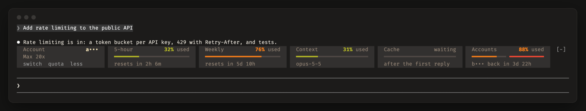
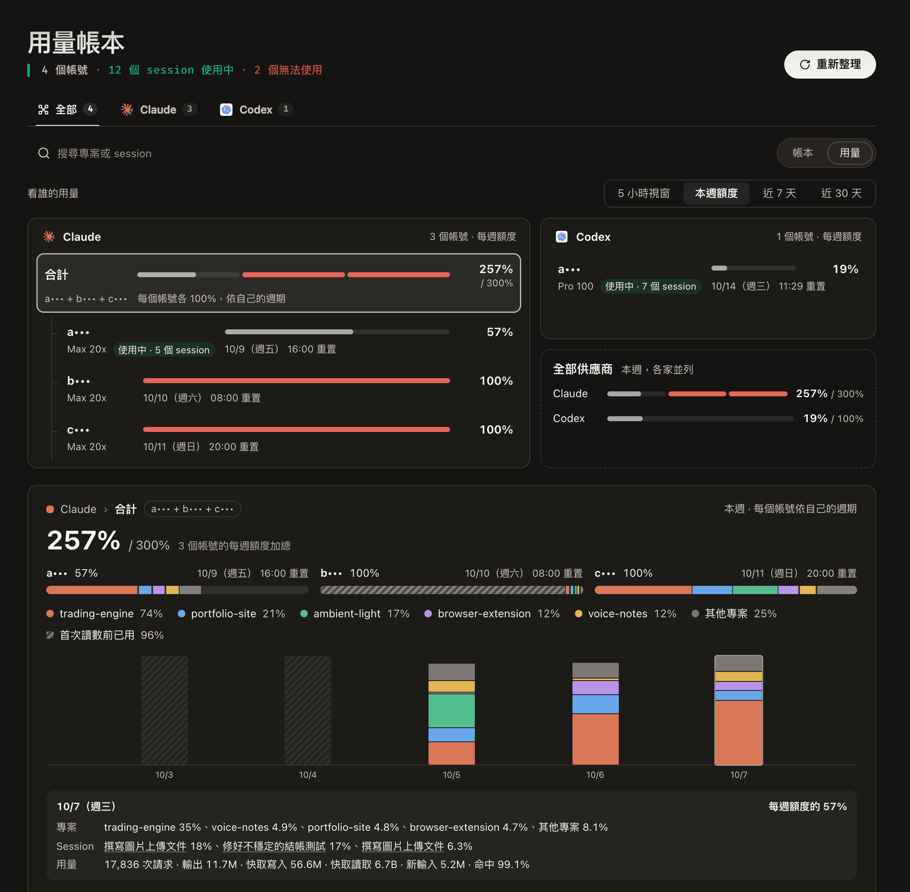
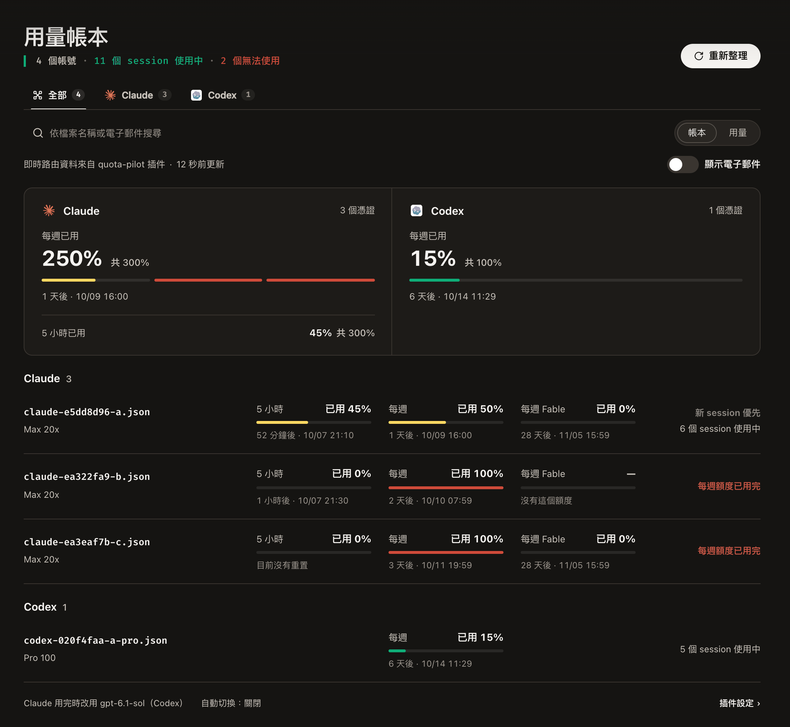
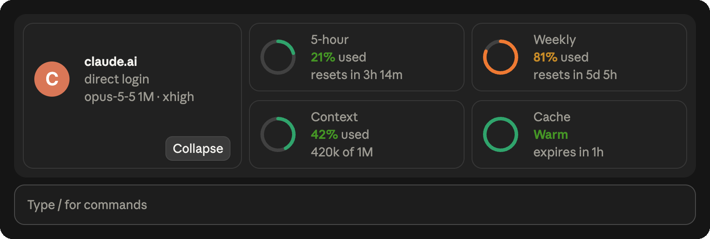
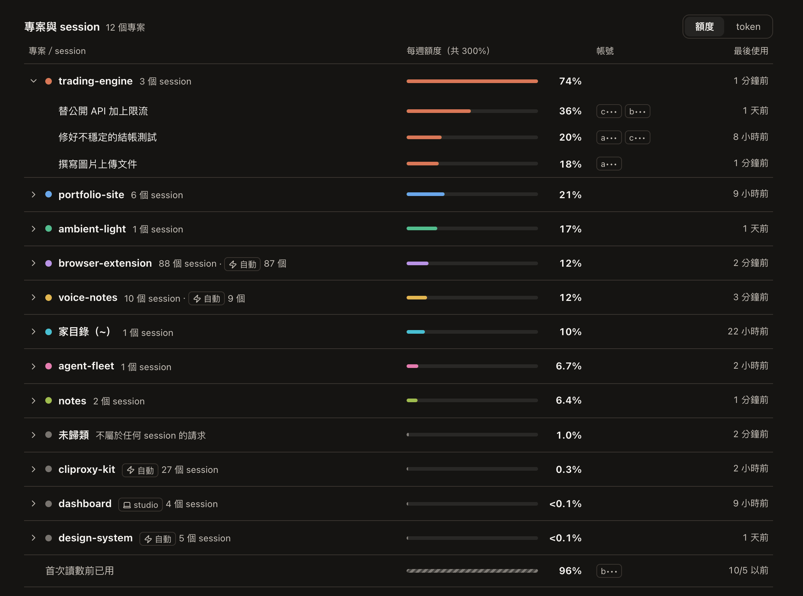

<p align="center">
  
</p>

<h1 align="center">cliproxy-kit</h1>

<p align="center">
  <b>讓每個 Claude Code session 都跑在對的訂閱帳號上，<br>也看得清楚額度用到哪裡去。</b>
</p>

<p align="center">
  <a href="https://github.com/kuan0808/cliproxy-kit/actions/workflows/ci.yml"></a>
  <a href="https://github.com/kuan0808/cliproxy-kit/releases/latest"></a>
  <a href="LICENSE"></a>
  
</p>

<p align="center">
  <a href="#快速開始">快速開始</a> ·
  <a href="#使用">使用</a> ·
  <a href="#設定">設定</a> ·
  <a href="#疑難排解">疑難排解</a> ·
  <a href="docs/architecture.md">運作原理</a>
  <br>
  <a href="README.md">English</a> · 繁體中文
</p>

<p align="center">
  
</p>

給透過 [CLIProxyAPI](https://github.com/router-for-me/CLIProxyAPI) 使用多個訂閱帳號跑 Claude Code 和 Codex 的人：一個 proxy 插件（**quota-pilot**），附帶管理面板裡的用量頁，以及 Claude Code 裡的額度列（**quota-band**）。

- 🧭 **每個 session 分到對的帳號。** 新的 session 分到每週額度最快重置的帳號，快過期的額度先用掉；之後就留在那個帳號，prompt 快取也跟著保留。Codex 的 session 和 review 也一樣。
- 📊 **額度用到哪裡去。** 管理面板裡的頁面，把每個帳號的 5 小時視窗、這一週、近 7 或 30 天，依專案和 session 拆開。
- 🎛️ **在工作的地方看額度。** Claude Code 輸入框上方的額度列，終端機和桌面版都有，顯示帳號、用量、context 和 prompt 快取，一鍵就能切換。
- 🧊 **不再意外冷啟動。** 下一輪要重寫 prompt 快取之前（快取過期，或 session 換了帳號或模型），額度列會說要重寫多少、以 API 價格計算要花多少，也能交接到從摘要開始的新 session。還可以打開「長對話的訊息先停下等你確認」和「你離開時保持快取」，只對一個 session 或對全部。
- 🔀 **供應商之間交接。** Claude 帳號全部用完時，session 可以手動換到 Codex 的模型，也可以設定成自動。

<table>
  <tr>
    <td width="50%"><b>用量</b>：每個帳號這一週，依專案和日期</td>
    <td width="50%"><b>帳本</b>：依分配順序列出每個帳號</td>
  </tr>
  <tr>
    <td></td>
    <td></td>
  </tr>
</table>

> [!NOTE]
> **預覽版。** 1.0 之前，設定和資料檔都可能變動。支援 Claude 和 Codex 帳號；其他供應商照常由 CLIProxyAPI 自己分配。

## 快速開始

需要 macOS 或 Linux 上的 [CLIProxyAPI](https://github.com/router-for-me/CLIProxyAPI) 8.0.14 以上，並已登入你的帳號；以及 [Claude Code](https://code.claude.com) 2.1.287 以上。

**1. 安裝 quota-pilot。** 在 CLIProxyAPI 的 `config.yaml` 開啟插件，並加入這個商店：

```yaml
plugins:
  enabled: true
  store-sources:
    - "https://raw.githubusercontent.com/kuan0808/cliproxy-kit/main/registry.json"
```

接著在管理面板的**插件商店**安裝 **Quota Pilot**，重新整理面板：它的頁面在**插件**底下。

<details>
<summary>手動安裝，或從原始碼安裝</summary>

- **手動：** 從 [release](https://github.com/kuan0808/cliproxy-kit/releases/latest) 下載你的系統的 zip（Apple 晶片選 `darwin_arm64`，大多數伺服器選 `linux_amd64`），把裡面的程式庫放進 CLIProxyAPI 的插件資料夾（`plugins.dir`），設定 `plugins.configs.quota-pilot.enabled: true`，再重新啟動 CLIProxyAPI。
- **從原始碼**（需要 Go 1.26、Bun 和 C 編譯器）：`scripts/install-plugin.sh` 會建置、測試並安裝，由 Homebrew 或 systemd 執行的 proxy 會自動重新啟動，最後確認 proxy 跑的就是這個版本。其他執行方式請指定位置和重啟方式：`CPA_PLUGINS_DIR=/path/to/plugins CPA_RESTART_CMD="docker restart cliproxyapi" scripts/install-plugin.sh`。

</details>

**2. 安裝額度列。** 在 Claude Code 裡：

```
/plugin marketplace add kuan0808/cliproxy-kit
/plugin install quota-band@cliproxy-kit
/reload-plugins
```

<details>
<summary>也可以請 Claude 裝、用終端機，或從 clone 下來的資料夾執行</summary>

- **請 Claude 裝：**「從 kuan0808/cliproxy-kit marketplace 安裝 quota-band 插件，然後重新載入插件。」
- **終端機：** `claude plugin marketplace add kuan0808/cliproxy-kit && claude plugin install quota-band@cliproxy-kit`
- **從 clone：** `claude --plugin-dir ./cliproxy-kit/mod`，或把這個資料夾寫進 `~/.claude/settings.json` 的 `env` 底下的 `CLAUDE_CODE_PLUGIN_DIRS`。

</details>

額度列不經過 proxy 也能用，例如桌面版或直接登入 claude.ai：見[各部分單獨能做什麼](#有沒有裝額度列)。

**3. 讓 Claude Code 改走 proxy。** 在你執行 Claude Code 的機器上：

```sh
bash <(curl -fsSL https://raw.githubusercontent.com/kuan0808/cliproxy-kit/main/scripts/connect-claude-code.sh)
```

它會詢問一把 proxy 的 client key，確認 proxy 接受它，讓 Claude Code 改走 proxy；還沒裝額度列的話也會一起裝。開一個新的 session，額度列就會顯示 proxy 分給它的帳號。

<details>
<summary>它改了什麼（要手動設定時）</summary>

在 `~/.claude/settings.json`（舊檔會保留在旁邊，名為 `settings.json.bak-<時間>`）的 `env` 底下：

```json
"ANTHROPIC_BASE_URL": "http://127.0.0.1:8317",
"ANTHROPIC_AUTH_TOKEN": "<proxy 的一把 client key>",
"CLAUDE_CODE_PROMPT_CACHE_TTL": "1h",
"ENABLE_TOOL_SEARCH": "true",
"ENABLE_CLAUDEAI_MCP_SERVERS": "false"
```

1 小時的快取讓長 session 比較省；tool search 讓經過 proxy 的 prompt 保持精簡；claude.ai 的連接器無法經過 proxy 使用。

</details>

**4. 讓 Codex 經過 proxy**（選用）。quota-pilot 只看得到經過 proxy 的請求：照 CLIProxyAPI 的[Codex 指南](https://help.router-for.me/agent-client/codex)設定 Codex。

<details>
<summary><code>~/.codex/config.toml</code></summary>

```toml
model_provider = "cliproxyapi"

[model_providers.cliproxyapi]
name = "OpenAI"
base_url = "http://127.0.0.1:8317/v1"
model_catalog_url = "http://127.0.0.1:8317/v1/models"   # Codex 0.156 起需要
experimental_bearer_token = "<proxy 的一把 client key>"
wire_api = "responses"
requires_openai_auth = true
supports_websockets = true

[features]
api_key_model_discovery = true   # Codex 0.156 起需要
```

少了這兩行，Codex 0.156 以上讀不到模型的資料，請求會大很多。

</details>

**5. 在 Codex 裡顯示額度**（選用）。Codex 沒有可以自訂的狀態列，經過 proxy 時底部也不會顯示用量上限；加上兩個 hook 就會印出一行：session 開始時顯示帳號和用量，之後只在換了帳號、帳號用量超過 80% 或用完時才提醒。

<details>
<summary>加進 <code>~/.codex/config.toml</code>，key 和位址與上面相同</summary>

```toml
[[hooks.SessionStart]]
[[hooks.SessionStart.hooks]]
type = "command"
command = '''id=$(sed -n 's/.*[{,]"session_id":"\([^"]*\)".*/\1/p'); printf 'Authorization: Bearer %s\nX-Codex-Session: %s\n' '<proxy 的一把 client key>' "$id" | curl -fs -m 3 -H @- "http://127.0.0.1:8317/v0/resource/plugins/quota-pilot/codex?event=SessionStart"'''

[[hooks.Stop]]
[[hooks.Stop.hooks]]
type = "command"
command = '''id=$(sed -n 's/.*[{,]"session_id":"\([^"]*\)".*/\1/p'); printf 'Authorization: Bearer %s\nX-Codex-Session: %s\n' '<proxy 的一把 client key>' "$id" | curl -fs -m 3 -H @- "http://127.0.0.1:8317/v0/resource/plugins/quota-pilot/codex?event=Stop"'''
```

只需要 `curl`。Codex 第一次會請你確認信任這兩個 hook。每一行都以提示顯示，不會進到模型的 context。

</details>

### proxy 跑在哪裡

每個部分都只連 proxy 的位址，所以 proxy 可以和 Claude Code 在同一台、跑在容器裡，或是在完全不跑 client 的伺服器上。

| 情況 | 要改什麼 |
| --- | --- |
| **同一台機器** | 不用改：照上面步驟 1 到 5。 |
| **Docker** | 把 proxy 使用者的 `~/.cache/cliproxy-kit/` 放在 volume 上（大多數映像檔是 `/root/.cache/cliproxy-kit`），否則重新啟動就會遺失記錄和狀態。 |
| **另一台機器** | 透過加密的位址連到 proxy，例如 [Tailscale Serve](https://tailscale.com/kb/1312/serve) 提供的位址，再把這個位址交給連接指令和 Codex。 |

```sh
bash <(curl -fsSL https://raw.githubusercontent.com/kuan0808/cliproxy-kit/main/scripts/connect-claude-code.sh) https://proxy.example.ts.net:8317
```

- **裝置。** 前面有 Tailscale Serve 這類反向代理時，proxy 才知道請求從哪裡來：其他裝置的 session 會在用量頁標上裝置名稱（MagicDNS），查不到名稱時標成「其他裝置」。直接連到 port 的 client 無法區分。
- **名稱。** proxy 只有和 Claude Code 在同一台、用同一個使用者執行時，才會讀它的對話記錄。其他情況由額度列替每個 session 命名；沒裝額度列時，session 會沿用第一個請求當標題。
- **純 http。** 其他機器上的 `http://` 位址會被腳本拒絕；網路本身已經加密時（例如 VPN），可以設定 `ALLOW_HTTP=1`。

### 有沒有裝額度列

quota-pilot 單獨就能運作；額度列補上只有 Claude Code 裡才能顯示或做到的事，單獨也能用。

| | 只有 quota-pilot | 加上額度列 | 只有額度列² |
| --- | :---: | :---: | :---: |
| 每個 session 分到帳號，並保留 prompt 快取 | ✅ | ✅ | |
| 用量頁：帳號、專案、session | ✅ | ✅ | |
| 用量頁上 session 的名稱 | 第一則訊息¹ | Claude Code 取的標題，包含你改過的名稱，任何裝置都是 | |
| 同一個 repo 跨裝置算成一個專案 | 依資料夾 | ✅ | |
| 輸入框上方的帳號、額度、context 和快取 | | ✅ | 登入帳號自己的額度 |
| 手動切換帳號或供應商 | | ✅ | |
| 冷啟動前的提醒和費用、保持快取、交接 | | ✅ | ✅ |

¹ proxy 和 Claude Code 在同一台、用同一個使用者執行時，也會是 Claude Code 取的標題。

² 桌面版，或不經過 proxy、直接登入 claude.ai 的 Claude Code。

桌面版的 session 由 app 自己登入 Claude，完全不經過 proxy：proxy 不會替它們分配帳號，用量頁上看不到，也不能切換。桌面版登入的帳號如果也在 proxy 裡，它的用量仍會讓那個帳號的額度下降，用量頁會把這部分算成「未對應到請求」。

額度列用 Claude Code 本來就送的 key 讀額度，但 proxy 最近一週內要處理過這把 key 的請求才會給。所以剛安裝好，或隔了一週以上沒用，額度列會在第一則回覆之後才顯示額度。

## 使用

### 在 Claude Code 裡

Claude 等待時顯示方塊，工作時縮成一行：

| 額度列上的 | 意思 |
| --- | --- |
| **Account** | proxy 分給這個 session 的帳號（第一個請求之前標成 `expected`）、方案和模型。 |
| **5-hour**、**Weekly** | 那個帳號在各個額度週期的用量，以及何時重置。 |
| **Context** | 對話用了多少 context。 |
| **Cache** | prompt 快取還剩多久變冷；保持快取打開時，用 `kept warm 0/3` 計算刷新次數；變冷後顯示下一輪要重寫多少、花多少。 |
| **Accounts** | 所有帳號的每週用量，以及下次切換或新 session 會分到的帳號。 |
| **上方那一列** | 一次一件事：要你決定的問題、剛做完的結果，或提醒（proxy 正在 `retrying` 你的帳號、某個帳號 `resting`、還沒有回應、下一輪會冷啟動、session 換了帳號、context 快滿了）。 |

| 按鈕 | 作用 |
| --- | --- |
| `switch` | 把這個 session 換到另一個帳號，或另一個供應商的模型，也能換回來。快取還熱著時，會先說切換要花多少，也可以先交接。 |
| `hand off` | context 超過 60%、下一輪會冷啟動，或切換會造成冷啟動時，出現在上方那一列。Claude 寫一份交接筆記（目標、已完成、未完成、修改內容、注意事項、下一步，或[你自己定的段落](#自訂交接筆記)），清空對話，新的對話從筆記開始。輸入 `/handoff [訊息]` 隨時都能交接，訊息會接在筆記後面。 |
| `quota` | 所有帳號的各個額度週期，以及額度列的設定；輸入 `/quota` 也一樣。直接登入 Claude 的 session 在同一個位置是 `settings`。 |
| `more` / `less` | 在換輪之前固定顯示方塊或一行（桌面版是 **Expand** / **Collapse**）。 |

**冷啟動之前。** 下一輪會冷啟動時，上方那一列會說要重寫多少。另外有兩個自動功能，預設都關閉，要你自己打開：

- `/hold-cold on`：對話超過 100k token 時，你送進冷啟動的訊息會先回到輸入框，上方那一列會問你：再按一次 **Enter** 就送出，也可以帶著它交接。
- `/keep-warm on`：你離開時，額度列最多刷新快取三次，每次在快到期前，用快取讀取的價格。

`off` 關閉，`default` 回到 `/config` 的預設，只打指令會說目前的狀態。選擇在這個視窗開著時一直有效，包括 `/clear` 和交接之後；開新視窗、重開或接續另一段對話，就回到 `/config` 的預設。`quota` 面板會列出這兩項，各附一個切換按鈕。

**沒有人在看的 session。** 由 agent、排程或協調工具啟動 Claude Code 時，在環境變數設定 `QUOTA_BAND_UNATTENDED=1`：額度列在那裡一律不攔訊息、不保持快取，不管預設或指令怎麼設，它送進來的內容都會直接進去。

### 帳號失敗時

失敗的請求會先在 session 原本的帳號上重試，保住它的 prompt 快取；重試也失敗，session 才換帳號，額度列會依 quota-pilot 看到的情況說明原因。一直失敗的帳號會暫停使用。這些都不用設定；規則和數字寫在 [docs/architecture.md](docs/architecture.md#when-an-account-fails)。

| 情況 | 會發生什麼 | 額度列顯示 |
| --- | --- | --- |
| 很快就失敗（連線中斷、HTTP 529） | 在同一個帳號上重試，75 秒內最多兩次 | `! d••• returned HTTP 529 · retrying it in about 50s; k••• is next if needed`，成功後顯示 `↪ Stayed on d••• after HTTP 529 · the retry 61s later worked; cache kept` |
| 沒有回應 | 在同一個帳號上重試一次 | 等待期間顯示 `! no answer for 45s`，接著是 `! d••• hung for 2m 15s · retrying it, 40s so far; k••• is next if needed` |
| 重試也失敗 | session 換到另一個帳號，之後留在那裡 | `↪ Switched d••• → k••• · d••• hung for 2m 15s; the retry got no answer`，等 proxy 再次提供 d••• 時附上 `switch back` |
| 重試沒有回應 | 下一則訊息送到另一個帳號 | `! d••• got no answer · moves to k••• (3% used) on the next turn` |
| 帳號一直失敗 | 它暫停使用：只有其他帳號都無法服務時，新 session 才會分到它；它上面的 session 在下一輪換走 | `! d••• resting after 2 failures · moves to k••• (3% used) on the next turn`；Account 卡片顯示 `resting, back in 4m` |

> [!NOTE]
> 不會重試的情況：登入、額度、模型或請求本身的錯誤、其他狀態碼、暫停中的帳號，以及 Codex 的 session。不到 100k token 的 session 不會等 proxy 在狀態碼之後的暫停結束，而是立刻換帳號。proxy 的 `request-retry` 至少為 1（範例設定是 3）時，重試才會藏在同一個請求裡；設為 0 時由 Claude Code 自己的重試接手。

在桌面版裡，額度列畫成卡片，跟著 app 的淺色或深色主題，顯示那個帳號自己的額度（見[不經過 proxy 時](#有沒有裝額度列)）：

<p align="center">
  
</p>

### 在管理面板裡

打開**插件**底下的 **quota-pilot**。登入面板時勾選了「記住密碼」，頁面就直接沿用；否則每個分頁會詢問一次 management key。

- **帳本：** 依新 session 分配順序列出每個帳號、各額度週期，以及限制它的原因。
- **用量：** 每個帳號的 5 小時視窗、這一週，或近 7、30 天，依專案和 session 拆開，附上 token 和快取命中率。日期依你的時區劃分。
- **重新整理：** 立刻讀取每個帳號的額度，讀不到的帳號會列出來並說明原因。



### 值得知道

- **額度提前重新計算時**（例如變更方案），從那一刻重新計算；之前的用量仍在近 7、30 天的檢視裡。
- **Fast 模式：** Codex 的 Fast（`service_tier = "fast"`）以 2.5 倍速度消耗方案額度，也照這個比例計算。Claude Code 的 `/fast` 計入用量點數，不計入方案額度，所以不算進帳號的額度；經過 proxy 時，要設定 `CLAUDE_CODE_SKIP_FAST_MODE_ORG_CHECK=1`，Claude Code 才會提供 `/fast`。
- **多個 Codex 帳號**會像 Claude 帳號一樣分配 session；改用另一個供應商只適用於 Claude Code 的 session。

## 設定

在面板的**插件管理**頁面，或 `config.yaml` 的 `plugins.configs.quota-pilot` 底下：

| 設定 | 預設 | 作用 |
| --- | --- | --- |
| `min_five_hour_left_percent` | `25` | 新的 session 不會分到 5 小時額度剩不到這個百分比的帳號，除非它 30 分鐘內就重置。 |
| `cross_provider` | `off` | `auto`：某個供應商的帳號全部用完時，自動把 Claude Code 的 session 改送到 `fallback_map` 的模型；`off`：交給 `switch` 手動切換。 |
| `fallback_map` | 無 | 各供應商改用的模型，寫成 `供應商: 供應商:模型`，例如 `claude: codex:gpt-6.1-sol`。 |
| `idle_poll_minutes` | `10` | 多久讀一次閒置帳號的額度。 |
| `context_lengths` | 內建表 | 各模型的 context 大小，用來判斷對話放不放得進另一個模型。 |

額度列的設定在 Claude Code 的 `/config`，安裝時也會詢問：

| 設定 | 預設 | 作用 |
| --- | --- | --- |
| 建議交接的 context 用量 | `60` | context 用到這個百分比時，上方那一列建議交接。`0` 表示不建議。 |
| 冷啟動前攔下訊息 | 關閉 | 新的 session 是否攔下送進冷啟動的訊息；`/hold-cold` 只改一個 session。 |
| 攔下訊息的對話大小 | `100000` | 對話超過這麼多 token 時才攔下訊息；快取還熱著時切換帳號，也從這個大小起先說要花多少。`0` 表示任何大小。 |
| 你離開時保持快取 | 關閉 | 新的 session 是否保持快取；`/keep-warm` 只改一個 session。 |
| 保持快取的次數 | `3` | 每次你離開時最多刷新幾次，1 到 10。 |

費用是 Anthropic 和 OpenAI 的 API 定價，僅供比較：訂閱方案不是按 token 計費。沒有已知價格的模型只顯示 token 數。

#### 自訂交接筆記

交接筆記是照一段 prompt 寫的。想照自己的方式寫，把你的 prompt 放進 `~/.claude/quota-band/handoff-prompt.md`（有設定 `CLAUDE_CONFIG_DIR` 時放在那個資料夾底下）：每次交接都會重新讀取，改了不用重新載入；檔案是空的或不存在，就用內建的 prompt。Claude 最後一則回覆，以及你帶著交接的訊息，仍會附在它後面。

<details>
<summary>內建的 prompt，可以從這裡改起</summary>

```text
Write a handoff note so a new session can carry on this work without this conversation.
Use these sections, in this order, each as a markdown heading:
Goal (what the user wants, and why);
Done (what was finished, and how it was verified);
Not done (what is left, and what was tried that failed);
Changes (each file touched, and what changed in it);
Watch out (decisions made and why, and the limits and preferences the user stated, in their words where it matters);
Next step (the one exact next action).
Be specific: paths, commands, names, numbers. Write in the language the user writes in. No preamble.
```

</details>

## 它改了什麼

| 位置 | 內容 | 還原方式 |
| --- | --- | --- |
| CLIProxyAPI 的 `config.yaml` | 開啟 `plugins:`、加入商店，以及 quota-pilot 的設定 | 刪掉這些設定。 |
| proxy 使用者的 `~/.cache/cliproxy-kit/` | 狀態、請求記錄，以及每個 session 的資料（權限 0600；client key 只存雜湊） | 刪掉這個資料夾。 |
| 每台跑 Claude Code 的 `~/.claude/settings.json` | 步驟 3 的 `env` 設定；原本的檔案保留為 `settings.json.bak-<時間>` | 把備份放回去。 |
| Claude Code 的插件 | `cliproxy-kit` marketplace 和 `quota-band` | `claude plugin uninstall quota-band@cliproxy-kit` |
| 額度列那台的 `~/.cache/cliproxy-kit/handoff/` | 交接寫的筆記 | 刪掉這個資料夾。 |
| `~/.codex/config.toml`（選用） | 步驟 4 的 model provider 和步驟 5 的 hook | 刪掉這些設定。 |

## 更新與移除

- **更新：** 面板的插件商店會提供 quota-pilot 的新版本。額度列用 `claude plugin update quota-band@cliproxy-kit` 更新，或在 `/plugin` 的 **Marketplaces** 開啟自動更新；執行中的 session 用 `/reload-plugins` 載入新版。兩者一起改版，請一起更新。
- **從 0.1.16 升級：** 切換現在會說明原因。額度列和 quota-pilot 請一起更新：舊版額度列會把新版插件的每次切換都寫成 `was unavailable`，新版額度列則把舊版插件做的切換寫成 `reason not recorded`。
- **從 0.1.14 升級：** 冷啟動前攔下訊息和保持快取都改成預設關閉，要用時在 `/config` 對所有 session 打開，或用 `/hold-cold on`、`/keep-warm on` 只對一個打開。**攔下訊息的對話大小**或**保持快取的次數**設為 `0` 不再代表關閉：分別代表任何大小和刷新一次；攔下訊息的對話大小為 `0` 時，快取還熱著的每次切換都會先問。
- **從 0.1.6 升級：** 額度列改成全部走網路，用 Claude Code 本來就在用的 key，所以 `band_tokens` 不再讀取，可以從 `config.yaml` 刪掉。session、專案和記住的資料夾會自動移進 `usage/sessions.json`。
- **移除：** 在面板的**插件**頁面刪除 Quota Pilot，用 `claude plugin uninstall quota-band@cliproxy-kit` 移除額度列，其餘照上表還原。

## 疑難排解

| 你看到 | 這樣處理 |
| --- | --- |
| 從商店安裝失敗 | 面板只等 30 秒，從 GitHub 下載 2 MB 太慢就會失敗：改用手動安裝（步驟 1）。 |
| 桌面版的額度列還沒有額度 | 桌面版的 session 在第一則回覆時才回報額度。 |
| 插件底下沒有 quota-pilot | 重新整理面板，並確認 `plugins.enabled: true`。 |
| 額度列說這把 key 送出請求後才有額度資料 | 送出一個 prompt：proxy 最近一週還沒接受過這把 key 的請求。 |
| 額度列說額度資料太舊 | proxy 或裡面的插件停了：重新啟動 CLIProxyAPI。 |
| Claude Code 把訊息退回輸入框，寫著「held by quota-band」 | 攔下訊息已打開，而且下一輪會冷啟動：按 **Enter** 送出，或用 `/hold-cold off` 不再攔。會自動輸入內容到 Claude Code 的程式，啟動時設定 `QUOTA_BAND_UNATTENDED=1`。 |
| Mac 很忙時，頁面或額度列變慢 | Homebrew 把 proxy 當成低優先的服務執行。在 `~/Library/LaunchAgents/sh.brew.cliproxyapi.plist` 加上 `ProcessType` `Interactive`（`plutil -replace ProcessType -string Interactive <檔案>`），再用 `launchctl bootout gui/$(id -u)/sh.brew.cliproxyapi` 和 `launchctl bootstrap gui/$(id -u) <檔案>` 重新載入。`brew services restart` 會重寫這個檔案。 |
| 用量頁看不到 Codex 的 session | Codex 還沒經過 proxy（步驟 4）。 |
| Codex 說 hook 以代碼 7 或 22 結束 | hook 的位址沒有 proxy 回應（7），或那個 proxy 上沒有 quota-pilot（22）。 |
| Codex 帳號沒有 5 小時視窗 | 它的方案本來就沒有；頁面和額度列都會標明。 |
| 額度列顯示 `Switched d••• → k••• · reason not recorded` | quota-pilot 比額度列舊，不會記錄 session 換帳號的原因：到面板的插件商店更新它。 |
| 額度列顯示 `retrying it in about 50s` | quota-pilot 讓請求留在 session 原本的帳號重試，保住 prompt 快取。重試有回應後這一輪就在原帳號繼續，最多 75 秒後改由它寫的那個帳號接手；按 `switch` 可以立刻換。 |
| Claude Code 顯示 `API error · Retrying`，附上 `quota-pilot: … retrying it in about 50s` | quota-pilot 讓請求留在原本的帳號重試，保住 prompt 快取。最多 75 秒後就換到它寫的那個帳號；按 `switch` 可以立刻換。 |
| 額度列說 `got no answer · moves to k••• on the next turn` | 沒有回應之後的重試也沒有回應；你的下一則訊息會送到 k•••。不用做什麼。 |
| 請求卡住好幾分鐘 | 經過 proxy 時，Claude Code 沒有等待第一個位元組的上限，只有請求逾時 `API_TIMEOUT_MS`（預設 600 秒）。設短一點能更早結束卡住的請求，但也會切掉大型冷啟動 prompt 比較慢的第一個回覆。按 Esc 再送一次會換帳號；`switch` 隨時都能換。 |
| 重試出現在 Claude Code 的訊息上，而不是藏在同一個請求裡 | proxy 的 `request-retry` 是 0：要設為 1 以上，proxy 才會自己重試。 |
| Account 卡片顯示 `resting, back in 4m` | 那個帳號連續失敗兩次，正在暫停使用：session 會在下一輪換到能服務的帳號，暫停到顯示的時間結束，或在它第一次成功時結束。不用做什麼。 |
| 切換提示附上 `switch back` | session 離開的帳號現在又能接手。按 `switch back` 換回去，快取還熱著時會先問；quota-pilot 不會自己把 session 換回去，因為新帳號的快取才是熱的。 |

## 隱私與安全

- **單一擁有者。** proxy 的每一把 client key 都視為可信。proxy 接受過某把 key 的請求後，這把 key 就能讀到所有帳號的額度（遮蔽過的名稱，不含 email 或路徑），也能替它開的 session 命名、切換帳號。只把 key 給你願意讓他看到用量的人；從 proxy 移除的 key 最多還能讀一週。
- **留在本機。** 所有資料都放在 proxy 使用者的 `~/.cache/cliproxy-kit/`（權限 0600），client key 只存雜湊。除了轉送的請求，插件只會用帳號既有的 token 呼叫供應商自己的用量和帳號資料端點，以及查詢裝置名稱的 DNS。
- **對話記錄。** 它只讀自己那台機器上、同一個使用者的 Claude Code 對話記錄。
- **都在金鑰後面。** 頁面本身不含任何資料，一切都經過 management 路由讀取，需要 management key。額度列和 Codex hook 的路由需要 proxy 接受過的 client key。

## 開發

```sh
cd plugin && go test ./...                                   # 插件
cd ui && bun install && bun run verify                       # 頁面：測試、lint、型別、建置
cd mod && claude plugin test . && claude plugin validate .   # 額度列
```

`scripts/install-plugin.sh` 會安裝本機建置的版本。`git config core.hooksPath scripts/git-hooks` 會開啟 commit 前的憑證檢查（需要 PyYAML；讀 Codex 的設定需要 Python 3.11 以上）。打上 `v<版本>` tag 會發布商店安裝用的 release，版本必須和 `mod/.claude-plugin/plugin.json` 一致；release 說明是 tag 的訊息（`git tag -a`），一般 tag 則用那個 commit 的訊息。各部分怎麼決定、存了什麼：[docs/architecture.md](docs/architecture.md)。

## 授權

[MIT](LICENSE)。頁面沿用了 CLIProxyAPI 管理面板的樣式和元件，依其 MIT 授權使用（[ui/LICENSE.panel](ui/LICENSE.panel)）。

與 Anthropic、OpenAI 或 CLIProxyAPI 專案無關。透過 proxy 使用訂閱帳號可能違反供應商的條款；使用前請先確認，並自行承擔風險。
