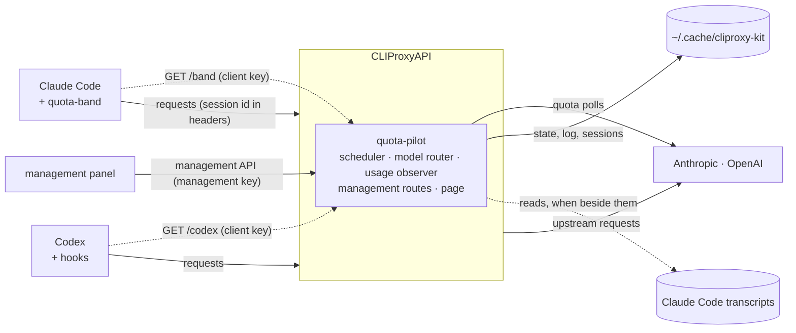

# How cliproxy-kit works

Three parts, one version, released together:

| Part | Folder | Language | Runs in |
| --- | --- | --- | --- |
| quota-pilot | `plugin/` | Go, built as a C shared library | CLIProxyAPI, through its plugin C ABI |
| quota-pilot page | `ui/` | React, built into one HTML file | the management panel, served by the plugin |
| quota-band | `mod/` | TypeScript | Claude Code, as a mod (function hooks) |

## quota-pilot

The plugin declares five capabilities: `scheduler` (across priorities), `model_router`,
`usage_plugin`, `request_interceptor` and `management_api`. It is the only place that chooses an
account and the only producer of quota data; the band and the page only read it.

### Choosing an account

Every pick that carries a session id (Claude Code's header, or the host's canonical id, as for
Codex) is answered with a concrete account, so the native selector never moves a session; a pick
without one is left to the native selector. A session's account is bound per conversation thread
and provider, and inherited by its subagents; a Codex request is a thread of its own, so a review
Codex runs beside a session gets its own binding. A side request (a Claude request without tools or
a thread, as a title or a summary) takes the session's account and never moves it. A new binding
takes, in order:

1. the account the user switched the session to, when it is offered;
2. accounts with weekly quota left for the model and enough of their 5-hour window: at least
   `min_five_hour_left_percent` (25 by default) left, or a reset within 30 minutes. Among these the
   soonest weekly reset comes first, so quota that would expire unused is used first; a model with
   a weekly window of its own (Fable) goes by that window's reset;
3. accounts whose quota is not known yet;
4. accounts low on their 5-hour window, or used up.

Within each, an account that can serve the model comes before one that cannot (its own weekly
window used up, as Opus's), and ties break by account id. The threshold is compared after rounding
to the whole percent the provider reports. A binding moves only after a success elsewhere: when its
account stops being offered (removed, used up), not on a failed retry, a side request or a
subagent; a cooldown the host already took into account when it offered the candidates does not
count again. Only a 429 is a quota refusal, and a refusal moves only the model it was for: a
session refused for Opus keeps its account for Sonnet. A request's send time goes with its
binding, and moves on with each later request its account serves, so an answer sent before
either and arriving late does not take the thread elsewhere.
An account read as used up often answers a while longer, so its sessions stay until it turns a
request away; from then on each of them leaves at its next request for a ready account, without
waiting to be refused itself. It also moves when its session has been idle for an hour, so its
prompt cache is gone anyway, while its account is no longer one a new session would get: the next
request goes to the best account at no cost. A session the user switched stays. A binding or route
the proxy chose lives in `state.json` for 24 hours after its last use, and one the user chose for 30
days, as long as Claude Code keeps a session to resume, so a resumed session keeps its account,
route and prompt cache.

### When an account fails

quota-pilot never changes the proxy's own state: the proxy's cooldown decides which accounts are
offered, and quota-pilot chooses among them. What it adds:

1. **Classify.** Each failed attempt gets a kind from its status, error body, time to first
   response and wait (see [Where quota went](#where-quota-went)).
2. **Move.** The proxy gives a failed request to another account; the success there moves the
   session, and its switch record says why (see [quota-band](#quota-band)). quota-pilot never moves
   a session back on its own: the new account's cache is the warm one.
3. **Rest.** An account that keeps failing rests, what other proxies call a circuit breaker:
   failures that end within 10 s of a moment's first failure are one failure moment (requests that
   hung from different times and failed together, or several sessions at once), and only hang,
   connection, timeout, overloaded and server failures count, the ones the proxy cools no account
   for, or only briefly; after the others (rate, quota, sign-in, model, request, other) the proxy
   holds the account back itself, for as long as it judges. A second moment within 15 minutes, with
   no success on the account between, rests it for 5 minutes.
4. **Trial.** After a rest the account is on trial until it serves: one failure moment rests it
   again at once, for twice as long (10, 20, 40, then 60 minutes at most). One success ends a rest
   or a trial, and the count starts over.

While an account rests it ranks after every account that can serve and is not resting, whatever
their tiers, so a new session gets it only when nothing else can; its sessions move at their next
turn to such an account when one is offered (the move's kind `rest`), and stay when none is.
Requests already running on it are left alone. Rest is not a quota limit: a resting account is not
used up, a provider whose accounts all rest is not exhausted, and `cross_provider: auto` never
moves a session to another provider for it. Before a session's next turn leaves a resting account,
the band warns and counts that turn as cold, toward the account a failover would take now: the
best-ranked other account, not resting, not used up, that a pick has listed for the session's model
since that account last failed (`switch_back`'s evidence); with none known, no warning.

| Constant | Value | Why |
| --- | --- | --- |
| Failure moment | 10 s | Requests that hung together, or several sessions at once, are one event, not several |
| Second moment | within 15 min | Two separate failures close together; one failure is not a pattern |
| First rest | 5 min | Longer than the proxy's 60 s pause after a 529, short enough to lose little |
| Rest after a failed trial | doubled, 60 min at most | An account that fails again at once is still unwell |

### Moving a session to another provider

`cross_provider: off` (the default) never changes provider: the band offers a one-press switch to
the model `fallback_map` names. `auto` moves a session only when every account of its provider is
used up on fresh data, never on unknown data, with an account list read in the last 30 seconds, and
only when the conversation fits the target model's context (`context_lengths`, else a table by
model family). What a conversation needs is the larger of its last turn's tokens (Codex's cached
input counted once, kept across a restart) and its body (a token per 3 bytes, 1,600 per image or
file), plus the output it asks for. A thread
continuation sent to another provider is answered `400 thread_unsupported_request`, which makes
Claude Code resend the whole conversation. Moving to another provider is for Claude Code sessions:
Codex chooses its own model.

### Reading quota

Quota comes from the rate-limit headers of every response (Claude's `anthropic-ratelimit-unified-*`,
Codex's `x-codex-*`) and, for idle accounts, from each provider's usage endpoint every
`idle_poll_minutes`, using the account's own token through the host, four accounts at a time.
Polling pauses after 15 minutes without any request, because a plugin turned off in the config is
never told, and resumes with the next one; the page's Refresh reads every account at once and says
which it could not read and why (its login, refused, asked to slow down, another status, the
network, an unreadable answer, or out of time). A usage-endpoint reading is complete: a window it does
not name (a Codex plan without a 5-hour window, a Claude model window such as Fable's that the
account lacks) is gone, and the band and the page say the account has no such limit; a Claude answer
that names no window at all is no reading. Headers name only some windows and never remove one. A Claude account's
plan is read from its profile, whether or not its usage read worked, when first seen, every hour,
on Refresh and after its window started over; a Codex plan comes with each usage reading. The last
readings survive a restart in `state.json`, marked stale as they age.

The live state and the report follow one set of window rules (`core/window.go`):

- A reading names its window by the reset it reports; one naming an earlier reset is late and
  passed over, one naming a later reset begins a new window.
- Within a window the highest reading stands, whatever order the readings come in. A reading read
  before one already taken (a long request's headers, timed when it was sent) says nothing newer.
- A fall of more than 5 points waits up to 5 minutes. It is the window starting over in place (a
  plan change, a reset the user asked for; Claude keeps the reset time) when the last reading of the
  window within those 5 minutes is nearer the fall than the highest, or none comes; otherwise it was
  a late reading. After a start-over, readings nearer the old highest within 5 minutes are late.
- For an hour after a plan change any fall starts the window over.

### Where quota went

Every request is logged (`usage/YYYY-MM.jsonl`, three months) with its session, account, model,
tokens, whether it came from another device, and the service tier it asked for (`auto` when it named
none) and the one the provider reported (Codex sends Fast as `priority`). The ChatGPT backend that
answers a Codex account signed in with ChatGPT reports `default` whatever tier served the request
(Fast measured 1.5x as fast and still read `default`), so its report is not kept. Each rise of an
account's weekly reading is shared among the requests since the previous rise, weighted by tokens
(output 5x, cache write 2x, cache read 0.1x), model tier and speed: Codex's Fast counts 2.5x, as
Codex's pricing says, and Claude's fast mode 0, as it draws on usage credits, not plan limits, so a
rise read beside only fast-mode requests is use elsewhere. A
rise no request explains, such as use on claude.ai or another tool, is reported as not matched to
a request; what the first reading already showed used is reported apart and never split. A range is
known only from readings inside it, so an account without one shows as unknown, not as 0%.

A failed attempt is logged too, once, with its kind (`f`: request, model, quota, sign-in, hang,
connection, timeout, overloaded, server, rate, other), its status (`st`), how long it waited (`w`,
ms) and its time to the first response (`ttft`, ms, absent when none came), never its error text:
as its request line when it ran tokens (a Claude stream that broke after `message_start`), as its
quota reading when it carried one, else as a line of its own. A successful request's line has its
`ttft` too, and `fw`, the client's wait from the request reaching the proxy to that first
response, which covers every failed attempt before it: a lower bound, as the attempt's own time
before it is sent is not measured. `ttft` is what the proxy records: for Claude the first response
bytes, an error body included; for Codex the first token event, else the first packet. Each change
of a session's account is logged as an event line (`ev: move`, its kind and cause, from and to).
Failure lines with neither tokens nor a reading, and event lines, are left out of every report, so
no report changes by them.

The kind is read from the status, the error body, `ttft` and the wait, in that order: a client
cancel (499) and what the proxy itself reads as the request's fault (`core/faults.go`, pinned
against the proxy below) are `request`; a model the account does not serve is `model`; a 429 while
the account reads as used up is `quota`; 401, 402, 403 and a refused grant are `sign-in`; no
response in 30 s after waiting 30 s or more is `hang`; then a lost connection, a timeout, a 529, any
other 5xx, a 429, anything else. A compact request's failure is `request` unless it is a sign-in,
a 429 or a Cloudflare challenge, as the proxy leaves the account alone after it.

The report runs the window rules above over the logged readings, so it and the live state agree; a
plan change is logged as a line of its own, after which a request's use is learned anew, and the
current week counts from where it started over. A fall within 5 minutes of the report's end still
waits, as it does live. Days are the page's: it sends its time zone, and days, ranges and session
timelines follow it. Use read across midnight counts in the total, on no day, and the days it may
lie on say their figure is a floor, or not known.

An account logged in again under a new credential is the same provider account (a Claude seat, its
`account_uuid` in its `organization_uuid`, so personal and Team seats stay apart; a Codex
`account_id`; kept 100 days): the report counts it as one, and while the proxy holds both
credentials the snapshot names the second as the same account, so the ledger, the band and the
report count its quota once. Accounts are named by masked labels, kept apart with more letters, then
a number, when two would read alike.

The report reads the log from memory: the last 38 days are read from the files once, shortly
after start, and each line is added as it is written, every account's in time order. A report
then walks only the lines of its range. A transcript is read once from its start for its folder,
how it was run and its first request, then only for what was written since; where a folder
belongs is looked up again after ten minutes. A busy machine gives the proxy, a background service,
little CPU, so a report that did all of this anew took seconds and grew with the log. The page
waits 30 seconds for a read; one that fails keeps what was read before and says why.

Over 5 hours the same split runs on the 5-hour readings: each account's running window, and the
windows of the last day, told apart by the reset each reading names (logged from 0.1.4 on, so
earlier windows are not listed). For an idle account Claude still names a reset, a later one with
each reading: a window that used nothing and served no request shows as not running.

Each session has one record (`usage/sessions.json`, kept as long as the log), filled by whichever
source knows it. Its title is the current one, from its transcript on the proxy's machine (the
user's rename, else Claude Code's title) or from the band on any device; until it has one, its
first request. The folder it started in, how it was run and its first request also come from its
own requests: Claude Code's system prompt and User-Agent, Codex's environment context and
originator. What a transcript said stays after Claude Code deletes it (30 days by default).

A request came from another device when the last `X-Forwarded-For` entry (which a reverse proxy
such as Tailscale Serve appends, so a client cannot forge it) is not one of this machine's
addresses; a container on this machine that reaches the port directly is not told apart. That
device is named by the name DNS gives its address (MagicDNS on a tailnet), looked up apart from the
request. A session's device and what ran it are two tags on the page.

Sessions are placed in projects by their repository. The band names it by its remote
(`github.com/owner/name`), the same on every device and in every worktree, and a session no band
named in one of that device's folders, as a Codex session, joins it. Otherwise a session that ran
on the proxy's machine (its transcript is here, or no band placed it) is placed by the nearest
`.git`, `.jj` or `.hg`, with worktrees (relative ones, and those of a bare repository) under their
main repository, remembered once the folder is gone. A folder outside any repository is its own
project. A session its band placed, and a folder on another device, on Windows or on a share, is
never looked up: its project is the repository root its device named, else its folder's name. A
repository known by no remote on another device stays that device's own; one path on two devices is
told apart by the repository's remote, else the device's name. Codex counts only what goes
through the proxy, as Claude does, so Codex should be set up to use it (see the README).

### Files

All under `~/.cache/cliproxy-kit/` of the user the proxy runs as, mode 0600, so one proxy per user:

| File | What |
| --- | --- |
| `state.json` | bindings, routes, sessions, the last quota readings, and the client keys the proxy accepted (as hashes) |
| `usage/` | the request log (`YYYY-MM.jsonl`) and what is known of each session (`sessions.json`) |

Nothing else reads them: the band and Codex hooks ask the proxy over the network, so the proxy can
run in a container or on a server that runs no client. A container needs a volume for this folder,
or a restart loses the log and the state.

### Management routes and the page

Under `/v0/management/quota-pilot/`, behind the management key: `snapshot`, `usage` and
`usage/session` (each with `tz`, the page's time zone), and `POST refresh`, which answers
`{read, failed: [{account, label, failure, status}], complete}`. Three resources, which CLIProxyAPI
serves without authentication under `/v0/resource/plugins/quota-pilot/`: `ui`, the page (it carries
no data and asks the management routes for everything); `band`, the snapshot for the band; and
`codex`, the notices for Codex hooks.

`band` and `codex` need a client key the proxy accepted for a request in the last week: a usage
record names the key the proxy let in, and the plugin keeps its SHA-256, never the key. A proxy
without `api-keys` lets every client in, and so every band, until a request with a key shows it
asks for keys; one without a key sent before that, answered late, does not open it again. The
band's snapshot carries opaque account ids and no emails or paths. A session belongs to the key
whose request it first served, for as long as an account or a route the user chose for it lasts:
only that key's band sees it, switches it and names it, and only that key's Codex hook hears of it;
anyone may name a session the proxy has not seen.

## The page

One HTML file, built from `ui/` with the panel's own styles and components (MIT, see
`ui/LICENSE.panel`), embedded in the plugin. The panel lists it under Plugins and shows it in a
frame; only the panel's origin may frame it (`frame-ancestors 'self'`). It uses the management
key the panel saved when "remember password" was ticked, else one typed into the page and kept for
the tab; a refused key is not retried, since five wrong keys ban the address for 30 minutes. It
follows the panel's theme, language and width.

## quota-band

The band draws above the Claude Code prompt, in a terminal and in the desktop app. What it shows is
decided once (`view.ts`: the facts, and the one row above the band) and drawn per surface: in
character cells in a terminal (`terminal.tsx`), and as cards in the desktop app (`desktop.tsx`),
whose font is proportional, whose widths are CSS lengths and whose colours follow its light or dark
theme. Both show cards while Claude waits and one line while it works (also when another mod draws
beneath it), and the row says one thing at a time: a question, what came of an action, or an alert
(the proxy's, a cold next turn, a session moved, a full context), in that order.

Everything it shows of accounts comes from `/band`, read every 10 seconds at `ANTHROPIC_BASE_URL`
with `ANTHROPIC_AUTH_TOKEN` (else `ANTHROPIC_API_KEY`, else no key, for a proxy without `api-keys`),
the same wherever the proxy runs. Each read sends what only the band's device knows of the session
in `X-Band-*` headers, kept out of the proxy's request log: its title, the folder it started in, its
repository's root and remote, and the model it uses, for which the snapshot names the account a
new session gets, ranked as a pick ranks them (an estimate: the host may also leave out an account
that does not serve the model).
Resources are read-only routes, so a switch, route or back goes with the next read in
`X-Band-Command`, and the snapshot that read returns acknowledges it; one not acknowledged within a
minute, or across a proxy restart, says so. When `/band` gives nothing the band says why (a key the
proxy has not accepted yet, no plugin there, no answer) and keeps the last snapshot, marked old.
The switch list leaves out accounts that cannot serve the session's model and second credentials
of an account.

A move is worded from the session's switch record (`last_switch`), which quota-pilot writes where
the main conversation's binding changes account and nowhere else: at the success elsewhere that
moves it, and when a switch of the user's is applied. Its `kind` and `cause` say why, only with
evidence: a failure of the account it left (`d••• hung for 2m 15s`, `d••• returned HTTP 529 twice`,
`d••• refused sign-in (HTTP 401)`, `d••• cannot serve opus-5-5`), a refusal while used up, an idle
move, an account removed or disabled, the user's own switch; with none seen, `the proxy left d•••
out; no failure recorded`. Never from the account's state now: a record of an older plugin, without
a kind, says `switched by you`, `moved while idle` or `reason not recorded`. The move row offers
`switch back` while the snapshot's `switch_back` names the account it left: quota-pilot says so per
model, each snapshot, only when that account is held, enabled, not used up for the model, and
listed by a pick for that model since its last failure (any failure, any model, as quota-pilot cannot
always tell which ones the proxy cools an account for). It never moves a session back by itself.
A row too wide for the band draws its short form (`↪ Switched d••• → k••• · d••• hung`); the
Codex notice says the same words (`mod/tests/moves.js` holds both sides' expected wording).

A session signed in to Claude directly reads no proxy. The desktop app's are: it points them at
Anthropic's own API with the app's sign-in. The band then shows that account's own limits, as Claude
Code reports them after a reply, and leaves out what only the proxy has: accounts, switching and its
alerts. In place of `quota` it has `settings`, which opens the same pane with the band's settings
alone, as the pane does when the proxy gives no snapshot.

Context, cache and model come from Claude Code itself, so the rest works either way:

- **Cold turns.** The next turn finds nothing cached when the session moved to another account or
  provider since its last reply, its model changed, or the cache's time ran out (the TTL in use:
  `CLAUDE_CODE_PROMPT_CACHE_TTL`, else an hour on a subscription and five minutes on a key). The row
  says why and what the next turn rewrites, with an estimate at API list prices: the cache-write
  price of that TTL, against the cache-read price warm. A model without a known price shows tokens
  only. The cache meter starts only after a reply that read or wrote the cache.
- **Holding a message.** While holding runs, from `confirmColdAbove` tokens (0: any size) a message
  typed into a cold turn is dropped (Claude Code puts it back in the box) and the row asks; Enter
  again sends it. Never held: one with images (a plugin can resend text only), a command, one typed
  during a turn, and a cold turn already confirmed: Claude Code's own question on `/model`, or a
  move confirmed in the band. Holding turned off while a message is held, or while the hold is
  deciding, lets the message go and drops the question.
- **Moves.** A switch or route while the cache is warm asks first, from `confirmColdAbove` tokens
  whether holding runs or not (it follows a press), with what it costs, and can hand off first: the move then waits until the proxy has seen the new session, which it does after the
  note's turn (it refuses a command for a session it has not seen).
- **Handoff.** Claude writes a note over the conversation from its cache (`$.model.fork`), in fixed
  sections: goal, done, not done, changes, watch out, next step; or as the reader's own prompt in
  `<Claude Code's folder>/quota-band/handoff-prompt.md` says, read at each handoff, with the same
  context after it (the latest reply, a held message). The note is saved under
  `~/.cache/cliproxy-kit/handoff/` and read back, the conversation clears, and the new one starts
  from the note, sent at once with any held message after it (put in the prompt if that fails).
  Suggested at `handoffAt` percent of the context; `/handoff [message]` at any time.
- **Keeping warm.** While keeping warm runs and the session is idle, a fork shortly before the TTL
  ends (five minutes before, or a fifth of a shorter TTL) reads the cached prefix at the cache-read
  price, which keeps it for another TTL: up to `keepWarm` times (1 to 10) each idle stretch, only
  while the cache is still there, and not for a conversation under 20k tokens. A refresh checks
  again right before its fork, so one turned off meanwhile makes no call; one that finds another
  band action running tries again a few seconds later. Through the proxy it is a request of the same
  session.
- **Which runs.** Holding and keeping warm each run by the first rule that applies: never in a
  session whose launcher set `QUOTA_BAND_UNATTENDED` (any value but empty, `0`, `false`, `no`,
  `off`), since a held message there stalls whatever typed it; else this session's choice
  (`/hold-cold`, `/keep-warm`, or the pane's buttons: `on`, `off`, `default`); else the `/config`
  default (`holdColdDefault`, `keepWarmDefault`), off unless turned on. The size and the count only
  tune them. A session's choice lasts for the Claude Code window: the module keeps it, as the host
  wipes the band's state at every `session.end`, and mirrors it in `$.state` for drawing and across
  a reload; `/clear` and a handoff keep it, a resumed conversation or a new process starts from the
  defaults.

### Desktop preview

The desktop app draws a mod's tree with its own CSS: Box widths in `ch` (percent strings kept),
heights and vertical gap or padding as `calc(n * .5lh)`, `borderStyle` as a 1px theme border with
radius and padding, colour names as theme variables, plain Buttons as ghost buttons, Svg as an
`` that sees no theme variables, and the slot under AbovePrompt present even when empty.

To see the band there without the app: a scratch test in `mod/tests` (fixtures from
`band.test.ts`) prints `JSON.stringify(await ui.drawn())` for a `surface: 'desktop'` mount, a small
script maps that tree to HTML with the rules above, and a browser screenshots it; remove the scratch
files after. The app's dark theme, sampled: page `#151515`, band frame and card `#212121`, card
border `#373737`, composer `#1d1d1d` with border `#4a4a4a`, success text `#459625`, warning text
`#c78b28`, muted text about `#9c9a92`.

## Codex hooks

Codex shows no custom status line, so its quota comes through hooks (see the README). A
`SessionStart` hook and a `Stop` hook send the session's id to `/codex`, which answers in Codex's
hook output: at the start, a line on the account and how much of it is used (after the first turn
instead, when the start came before the key's first request); after a turn, a line only when
another account took the session, or a window of its account passed 80% or ran out.
Codex shows it as a notice, apart from the model's context. Without the hooks Codex shows nothing of
quota through the proxy: CLIProxyAPI does not pass on the rate-limit events its own footer reads.

## Upstream behaviour it relies on

Checked against CLIProxyAPI 8.0.16 and Claude Code 2.1.296:

- A scheduler plugin that handles a pick bypasses the native selector, session affinity included.
- Pick requests carry `canonical_session_id` (`claude:<session>`, with `:agent:<id>` for a
  subagent) and `parent_session_id`.
- Usage records arrive once per upstream attempt, failures included, with the rate-limit headers.
- Resources registered by a plugin are served under `/v0/resource/plugins/<id>/` without
  authentication, for GET only and without a body; its management routes need the management key.
- A usage record names the client key the proxy accepted (`config-api-key`'s principal), and none
  when the proxy has no `api-keys`.
- A plugin library replaced in place is loaded again only when the proxy restarts.
- The desktop app points its Claude Code sessions at Anthropic's own API with its own sign-in, so
  they bypass the proxy; a prompt a `prompt.submit` hook drops goes back into the prompt box.
- The desktop app lays a plugin's tree out as CSS: widths in `ch`, heights and vertical spacing in
  half lines, colour names from its theme, an SVG as an image that sees none of the theme. Beneath
  the band it draws a slot for the engine's own drawing, as an element even when that is empty.
- A plugin's `$.state` survives a module reload but is wiped at the end of every `session.end`, a
  `/clear` included, which no `session.start` follows; `classic.SessionStart` with `source: 'clear'`
  does. Every `$.state` read within one dispatch sees one moment, so a change made meanwhile by
  another hook is not seen there.
- Claude Code sends its session id in `X-Claude-Code-Session-Id`, and continues server-side message
  threads; an expired thread is answered `404 thread_not_found`, which CLIProxyAPI 8.0.14 and later
  pass through so Claude Code replays the conversation.

What CLIProxyAPI does around a failed attempt is pinned by the proxy contract test, which runs the
proxy's own account manager, API handlers and, in `plugin/contract_service_test.go`, its real
executors against a stub upstream, all in-process (`go test ./...` in `plugin/`; checked against
8.0.15 and 8.0.16). A proxy update that changes any of this fails that test:

- When quota-pilot declines the next pick of the same round after an attempt on A failed
  (`TestADeclineAfterAFailureWithThreeRetryRounds`): after a dropped or reset connection the proxy
  runs another request-retry round in which A is offered at once, so the retry stays inside the
  request; after a 408, 429, 500, 502, 503 or 504 the next round runs without A, which is cooling,
  so the client gets A's failure with its status; after a 520, a 529, another status such as 418,
  or a bare deadline (a 504 to the client) no round follows and the client gets the failure. With
  `request-retry: 0`, or the rounds spent, every failure goes back to the client; with A's own
  `request_retry` of 0 the rounds run without A; with `max-retry-credentials: 1` no pick follows the
  failure in its round and the next round decides (the tests named `...WithNoRetryRounds`,
  `...WhenAccountAOverridesRetryToZero`, `...WhenTheRoundsAreSpent` and
  `...WhenTheCredentialCapIsSpent`).
  Without a decline the request moves to another account in the same round.
- A decline on a request's first pick fails it with a 503 carrying the scheduler's reason
  (`TestADeclineOnARequestsFirstPickFailsItWith503AndTheReason`).
- The pick after a failed attempt names that account in `selected_auth_id`; the next round's first
  pick does not (`TestThePickAfterAFailedAttemptNamesTheAccountJustTried`; nothing relies on it).
- A request's usage records reach the usage plugin in the order they were published, one at a time:
  a failed attempt's before its retry's success, both with the request's trace id
  (`TestUsageRecordsReachThePluginInOrderOneAtATime`).
- A pick carries no request or trace id of the proxy's, only the client's own headers
  (`TestAPickCarriesNoRequestOrTraceID`), so a retry is scoped to the session's binding.
- What the proxy reads as the request's own fault, a model the account does not serve and a refused
  sign-in, ported in `plugin/core/faults.go`, agrees with the proxy on one corpus
  (`TestTheRequestFaultAndSignInPortsAgreeWithTheProxy`, `TestTheModelPortAgreesWithTheProxy`). The
  proxy reads a failure without the requested model, so a not-found error naming the model is a
  generic 404 to it, which cools that model for 12 hours like a model it does not serve.
- A pick lists an account for a model only while the proxy would serve that model with it
  (`TestAPickListsAnAccountOnlyWhileTheProxyWouldServeTheModelWithIt`): after a 529 it is left out
  for 60 s, after a 503 with `Retry-After: 120` for 120 s, after a 401 for 30 minutes, and after a
  connection error or a bare deadline not at all; an account cooling for one model is still listed
  for another; an Anthropic 429 with a unified rate-limit rejection leaves it out for every model
  (`TestAUnifiedRateLimitRejectionLeavesTheAccountOutForEveryModel`, through the real executor).
- Intercept sees the model the pick names, for a model alias (`team-opus`, which the record names
  `claude-opus-5-5`) and for a request routed to another provider (whose record's `Alias` is the
  client's model), and every usage record of the request carries the trace id Intercept saw
  (`TestInterceptSeesTheModelThePickNames`). A compact request reaches Intercept with its path in
  the metadata; after its 404 or 500 the account is left alone, after its 401 or any 429 it cools
  (`TestACompactRequestReachesInterceptWithItsPath`,
  `TestACompactFailureLeavesTheAccountAloneOnlyFor404And500`).
- A broken stream's failure record (`TestABrokenStreamsRecordTellsABrokenAnswerFromAHang`): a Claude
  stream dropped after its text keeps the usage seen so far and a `ttft` from its start; a Codex
  stream dropped after its text is a 408 with no tokens and an early `ttft`; a 504 after silence has
  its `ttft` at the 504; a connection dropped after silence has none.
- Request-retry rounds have no time limit: a connection lost 135 s into an attempt still leads to a
  round that offers A at once (`TestAHangsRetryRunsInsideTheSameRequest`), and the Claude handler
  writes no response headers before the first chunk, so the client sees a hang and its retry as one
  response (`TestTheClaudeHandlerWritesNoHeadersBeforeTheFirstChunk`).
- A client's cancel during an attempt records a 499 with its wait, with no `ttft` when nothing came
  and one once the stream had started (`TestAClientCancelRecords499WithItsWait`).

Claude Code, checked against 2.1.296 and again against 2.1.302: through a proxy it sets no limit on
the wait for a first byte (its first-byte watchdog runs only against Anthropic's own API); its
request timeout, `API_TIMEOUT_MS`, is 600 s by default, counted from sending the request until the
response headers arrive; and it retries a 408, 409, 429, 5xx or 529 up to 10 times.

## Limitations

- Rests and trials live in memory, like refusals: a proxy restart forgets them. An account that
  alternates failure and success never rests, as each success starts the count over.
- Crossing providers changes the model and rewrites the prompt cache; Claude Code does not know a
  non-Claude model's context size, so its auto-compact timing may be off.
- Remote Control, voice dictation and claude.ai connectors do not work through a proxy.
- The cache countdown, cold turns and keeping warm are estimates: the server's cache state cannot
  be observed, and a change Claude Code makes to its own prompt (`/reload-plugins`, another tool
  list) also starts the cache over.
- Prices are API list prices, for comparison: a subscription is not billed per token.
- Transcripts are read only on the machine that runs the proxy, as the same user as Claude Code.
  Elsewhere, and in a container, the band names a session, else its requests do; without the band a
  session there keeps the title of its first request, and its project is its folder's.
- A client key removed from the proxy can read quota with `/band` and `/codex` for up to a week.
- A proxy in a container that clients reach directly sees no `X-Forwarded-For`, so their requests
  are not marked as from another device.
- The plugin is trusted in-process code: a crash takes the proxy down with it.
